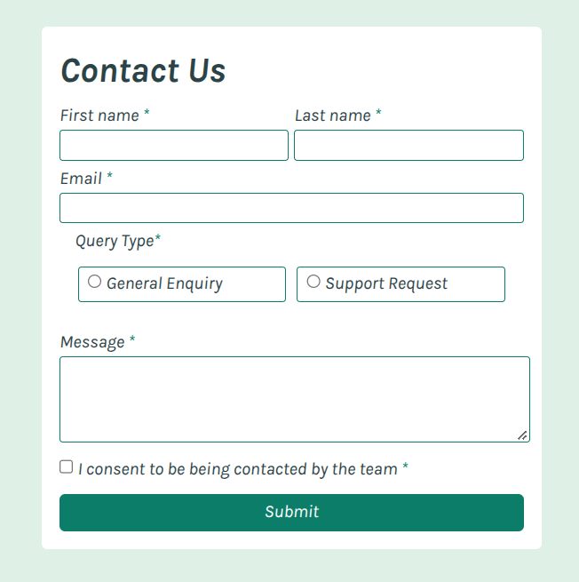
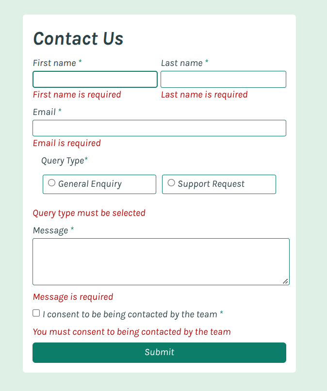

# Frontend Mentor – Contact Form

## Overview

This project is my solution to the [Contact Form challenge on Frontend Mentor](https://www.frontendmentor.io/). My main goal was to strengthen my JavaScript skills by implementing form validation and to gain practical experience writing tests with Jest.

I also focused on building an accessible, responsive form using semantic HTML and CSS Grid.

## My focus and key learnings

### HTML and accessibility

I focused on making the form accessible to people who navigate using a keyboard or screen reader. This included using semantic HTML, associating labels with form controls, and providing accessible feedback when validation errors occur.

### JavaScript and form validation

I focused on making the validation logic clear and maintainable by separating it from the HTML. I used `aria-invalid` to communicate the validation state of form controls and to help manage when error messages are displayed.

This helped me practise DOM manipulation, event handling, form validation and the relationship between JavaScript behaviour and accessibility attributes.

### CSS and responsive layout

I primarily used CSS Grid to create a flexible layout that adapts to different screen sizes. I also worked on styling interactive elements to provide clear visual feedback.

### Testing with Jest

I used Jest to practise testing JavaScript functionality. This gave me an opportunity to explore how automated tests can help verify behaviour and identify problems during development.

## Built with

- Semantic HTML5
- CSS3 and CSS Grid
- Vanilla JavaScript
- Jest

## What I learned

This project helped me understand how accessibility, validation and styling need to work together when building a form.

I particularly wanted to move beyond simply making the form work and think about how people interact with it, including those who rely on keyboard navigation or assistive technology.

I also gained experience using Jest to test JavaScript and began developing a better understanding of how to make code more reliable and maintainable.

## Future improvements

I would like to continue improving my automated testing, particularly by expanding test coverage for different validation scenarios and user interactions. I also want to keep developing my knowledge of web accessibility and how to test it effectively.

## Links

-

[View the source code on GitHub](https://github.com/Temceo/frontend_mentor_form)
[View the live site on netlify](https://mm-contactform.netlify.app/)

## Screenshots

